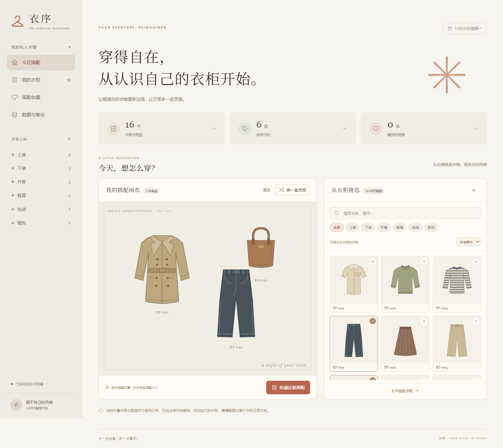

# 衣序 · Yixu Wardrobe

一个可以直接打开的私人衣柜与日常搭配应用。暖色、简洁的界面，使用原生 HTML、CSS 和 JavaScript 编写，无需安装依赖、后端或账号。

A local-first wardrobe manager and outfit canvas, built with plain HTML, CSS and JavaScript. No build step, server, account or external runtime dependencies.



## 开始使用

1. 下载本仓库 ZIP 并完整解压，或克隆仓库。
2. 使用 Microsoft Edge 或 Chrome 打开 `index.html`。
3. 编辑示例衣物，或添加自己的照片与衣物，开始整理。

页面可离线运行，也可以放到任意静态网站托管服务。

## 功能

- 衣物管理：新增、编辑、删除、编号查重、照片上传与自动压缩。
- 分类与筛选：自定义分类、品类、季节、状态、搜索、心爱单品。
- 批量整理：多选、全选当前结果、批量更改分类与状态、批量删除及撤销。
- 拖动管理：手动调整顺序，拖到侧栏分类归类。
- 搭配画布：点击或拖入单品，自由移动、缩放、移除与随机组合。
- 搭配收藏：保存、继续编辑、记录穿着次数、删除与撤销。
- 数据迁移：JSON 完整备份与恢复，CSV 清单导出与批量导入。
- 响应式布局：适配桌面与手机；搭配单品支持方向键移动。

随机搭配基于本地筛选与随机组合，不调用在线 AI。

## 数据与隐私

仓库只提供虚构的通用示例和原创 SVG 衣物插画，不包含个人衣物记录、照片、Excel 文件或备份。

修改保存在当前浏览器的 `localStorage`，上传的照片会压缩后随记录保存。应用没有上传接口或自动同步功能，也没有外部脚本、字体或分析服务。

清除浏览器数据、切换浏览器、使用隐私窗口或移动本地文件位置，可能无法读取之前的记录。请定期在「数据与备份」导出 JSON。内置插画使用相对路径，备份请连同应用文件夹一起保管。浏览器存储容量有限，添加大量自定义照片前请先备份。

## CSV 批量导入

文件使用 UTF-8 编码，第一行是列名：

| 列 | 说明 |
| --- | --- |
| 编号、名称 | 必填；编号在现有衣柜和本次导入中均须唯一 |
| 分类 | 留空时放入「未分类」，新名称会创建分类 |
| 品类 | 待细分、上装、下装、外套、连衣裙、鞋履、包袋、配饰、内衣 / 家居 |
| 季节 | 春/夏/秋/冬，可多选并用斜杠分隔；留空表示四季 |
| 位置、颜色、备注 | 可选文字 |
| 状态 | 在衣柜、闲置、待洗护；默认在衣柜 |
| 喜爱、穿着次数 | 可选；喜爱填「是」或「否」 |

CSV 用于新增物品，不会覆盖已有记录，也不包含图片。完整迁移使用 JSON 备份。可以先导出一份 CSV 查看列结构。

## 文件结构

```text
index.html          页面入口
styles.css          样式与响应式布局
app.js              交互逻辑、本地保存、导入导出
data.js             通用示例数据
assets/favicon.svg  应用图标
assets/items/       原创 SVG 衣物插画
docs/preview.png    使用通用示例生成的预览
scripts/check.mjs   可选的源码与示例完整性检查
```

代码无需构建即可运行。需要修改初始衣柜时，编辑 `data.js` 中的 `window.WARDROBE_SEED`；已存在浏览器数据的用户可通过「恢复内置示例」加载新初始数据，操作前请备份。

可选开发检查（需要 Node.js 18 或更新版本）：

```sh
node scripts/check.mjs
```

欢迎通过 Issue 提交问题或通过 Pull Request 改进。请勿在公开的 Issue、截图或提交中附上个人备份和私人照片。

## 许可证

代码和本仓库原创示例插画使用 [MIT License](LICENSE)。
